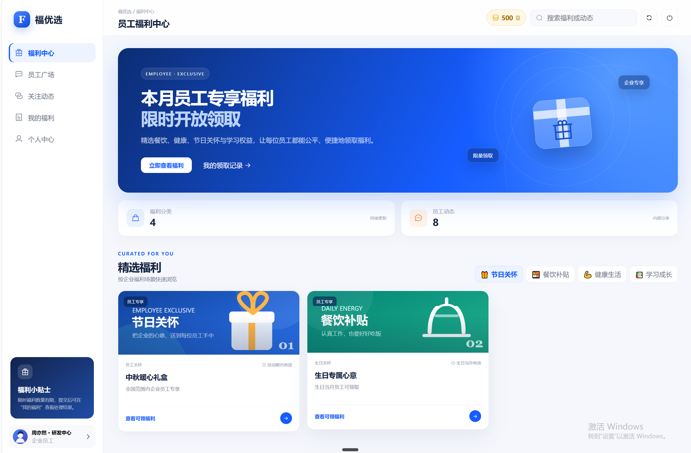
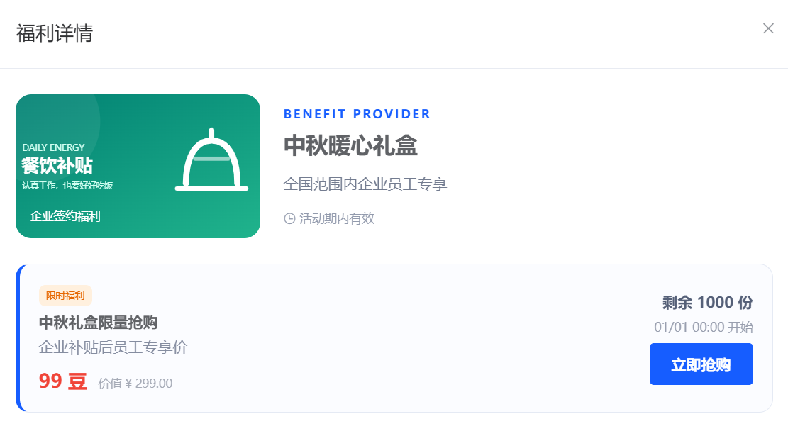
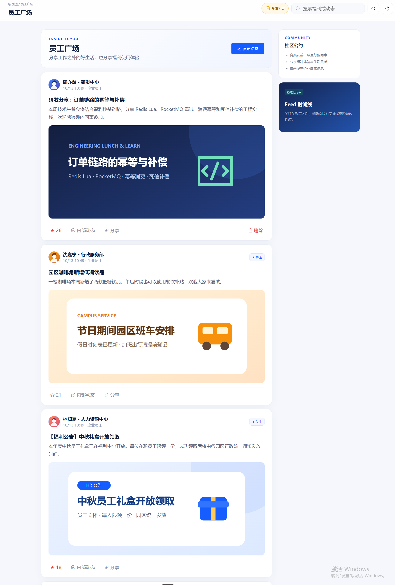
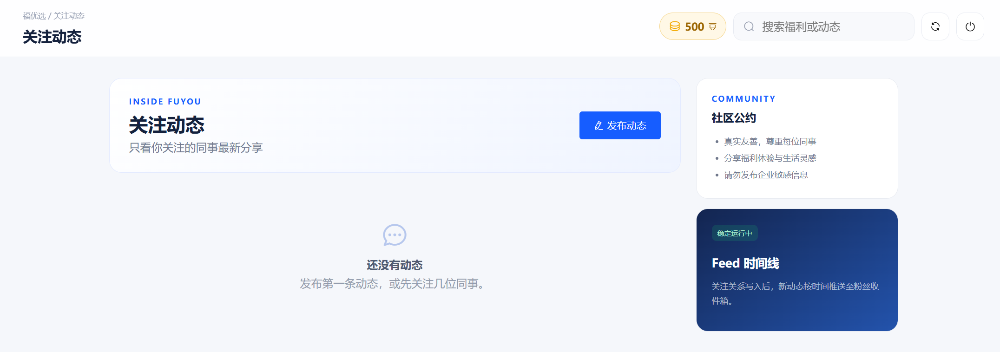
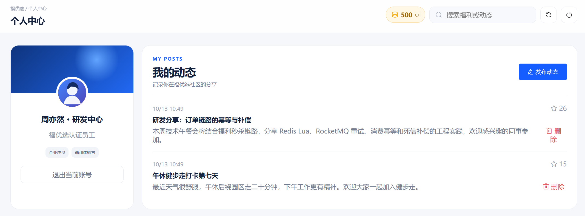

# 福优选：企业内部福利抢购平台

福优选是一套可直接运行的企业员工福利抢购与内部信息社区。仓库包含完整前端、Nginx 网关、双 Spring Boot 后端，以及 MySQL、Redis Sentinel、RocketMQ 和 Canal。项目不包含管理员后台，访问者以普通员工身份登录和使用。

## 项目演示

### 福利中心

聚合展示员工可领取的各类福利，并提供分类筛选、余额查看和领取记录入口。



### 福利详情与限量抢购

查看福利说明、活动时间、兑换价格和剩余库存，并在活动开放后参与限量抢购。



### 员工广场

员工可以发布内部动态、浏览同事分享，并进行点赞、关注和内容互动。



### 关注动态

集中展示已关注同事的最新内容，通过 Feed 时间线持续获取内部动态。



### 个人中心

展示员工身份与个人资料，并统一管理自己发布的动态和互动数据。



## 已实现

- 企业员工登录、信息帖发布、点赞、关注和关注动态推送
- 福利商品浏览、秒杀、异步下单和个人订单查询
- Redis + Lua 原子完成库存校验、一人一单、扣减、分布式 ID 和订单入队
- 独立订单 Worker 使用 16 个分片任务批量投递 RocketMQ，与两个 Web 后端隔离；包含 ACK、消费幂等、补偿和死信处理
- Caffeine → Redis → MySQL 多级缓存，支持空值缓存、随机 TTL 和 Redisson Watchdog
- Canal 监听 MySQL ROW Binlog，使 Redis 与两个后端实例的本地缓存失效
- Nginx 负载均衡两个后端，并缓存公开福利列表

## 一键启动

### 运行前准备

一键启动脚本会下载并配置 MySQL、Redis、RocketMQ、Canal、Nginx 和后端镜像，但**不会自动安装 Docker 本身**。运行项目之前，电脑必须先具备 Docker Engine 和 Docker Compose。

- Windows / macOS：推荐安装并启动 Docker Desktop。
- Windows + WSL2：也可以在 WSL2 的 Linux 发行版中安装 Docker Engine 和 Compose 插件。
- Linux：安装 Docker Engine 和 Compose 插件，并确保当前用户有执行 Docker 命令的权限。

安装完成后，新开一个终端并执行以下命令；两条命令都能正常显示版本号，才可以继续启动项目：

```bash
docker --version
docker compose version
```

如果电脑不能安装 Docker，就无法使用本仓库的一键启动方式。理论上可以手动安装并配置 Java 8、Maven、MySQL 8、Redis 7、RocketMQ 4.9、Canal 1.1 和 Nginx，但还需要自行完成账号、端口、网络及初始化配置，不建议用于首次体验。

首次启动需要联网下载镜像和构建后端，建议为 Docker 分配至少 8 GB 内存。

### 启动项目

Windows PowerShell：

```powershell
powershell -ExecutionPolicy Bypass -File .\scripts\docker-up.ps1
```

如果 Docker Engine 安装在 WSL2 中，请使用“以管理员身份运行”的 PowerShell。脚本会在项目运行期间保持 WSL2 在线，并在必要时自动修复 `localhost` 转发。

Linux、WSL2 或 macOS：

```bash
bash scripts/docker-up.sh
```

脚本会在首次运行时生成本机 `.env`，其中的 MySQL 与 Canal 密码均为随机值，不会提交到 Git。所有服务就绪后访问：

<http://localhost:8080>

输入任意合法的 11 位手机号，点击“获取验证码”。演示模式会在页面上显示验证码，输入后即可登录；不需要管理员账号。

> 同一台电脑默认只运行一份福优选。若已经从另一个目录启动过本项目，再启动第二份同名副本会复用已有容器和数据卷，可能因为两份 `.env` 的随机密码不同而启动失败。首次体验请直接使用一份项目；需要并行运行时，应为第二份配置不同的 `COMPOSE_PROJECT_NAME` 和 `HTTP_PORT`。

## 停止与重启

停止服务并保留数据：

```powershell
# Windows
powershell -ExecutionPolicy Bypass -File .\scripts\docker-down.ps1
```

```bash
# Linux / WSL2 / macOS
bash scripts/docker-down.sh
```

再次执行启动脚本即可复用数据。若要彻底清空演示数据并重新初始化，请确认无重要数据后执行：

```bash
docker compose down -v
```

常用排查命令：

```bash
docker compose ps
docker compose logs -f nginx app-1 app-2
```

## 默认组成

| 服务 | 数量 | 说明 |
| --- | ---: | --- |
| Nginx + 前端 | 1 | 唯一对外入口，默认端口 `8080` |
| Spring Boot | 2 | 内嵌 Tomcat，由 Nginx 负载均衡 |
| 订单 Worker | 1 | 独立执行 Redis 队列投递和 RocketMQ 消费落库 |
| MySQL | 1 | 主库，开启 ROW Binlog |
| Redis | 2 | 一主一从 |
| Redis Sentinel | 3 | 监控 `mymaster` 并提供主节点发现 |
| RocketMQ NameServer | 1 | 消息路由服务 |
| RocketMQ Broker | 2 | 一主一从 |
| Canal | 1 | 订阅 MySQL Binlog |

容器网络中的数据库、中间件和后端端口不会暴露到宿主机；默认只公开 Nginx 的 `8080` 端口。

## 功能验收

服务启动后，可选执行全链路功能检查：

```bash
bash scripts/smoke-test.sh
```

该脚本只验证登录、Nginx 缓存、关注/动态、发帖/点赞、秒杀异步落单、Canal 缓存失效和 Redis 主从复制，不执行性能压测。简历中的 TPS 和 RTT 数据应以独立压测环境与原始报告为准。

Java 单元及契约测试：

```bash
mvn test
```

## 部署到域名

在云服务器安装 Docker 后，克隆仓库并执行同一个启动脚本即可。将 `.env` 中的 `HTTP_PORT` 改为 `80`，或在容器前增加云负载均衡/HTTPS 反向代理，再把域名解析到服务器公网 IP。生产环境还应配置 HTTPS、短信服务、备份和访问控制；仓库的验证码展示仅用于体验。

## 目录

```text
frontend/                         企业员工前端与本地图片资源
src/main/java/com/fuyouxuan/      后端业务代码
src/main/resources/db/            演示数据库初始化脚本
docker/                            Nginx、Redis、RocketMQ、MySQL 容器配置
scripts/                           一键启停与功能验收脚本
compose.yaml                       完整服务编排
```

## 许可

本项目按 [MIT License](LICENSE) 发布。仓库内 Vue、Axios、Element UI 等第三方文件仍遵循各自的许可证。
